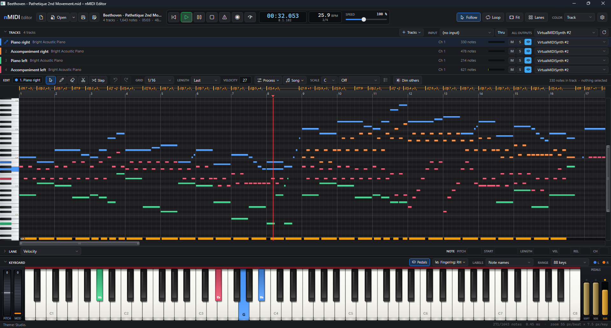
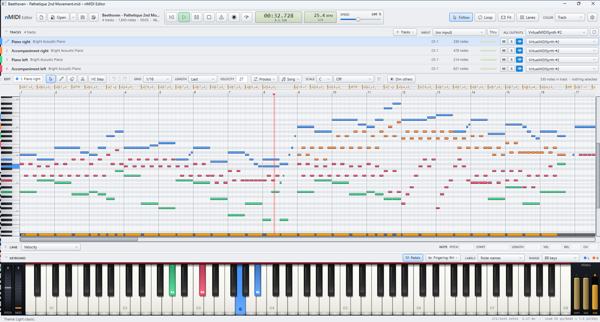
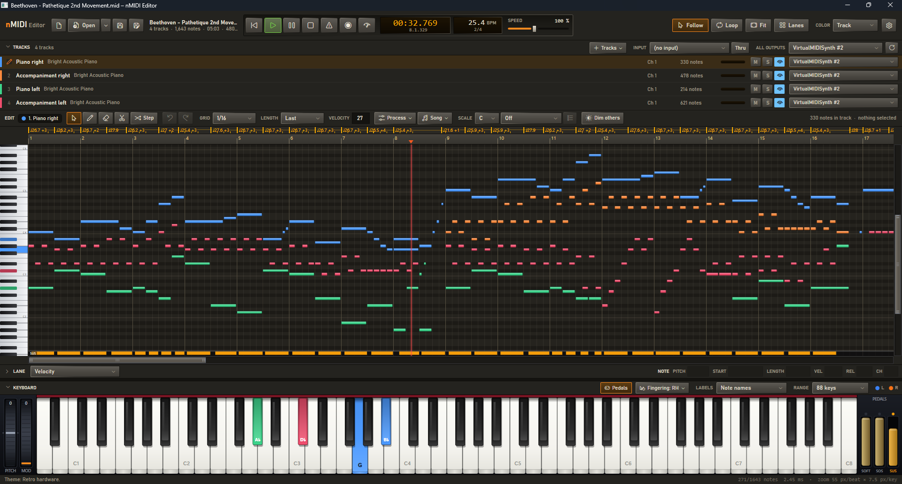
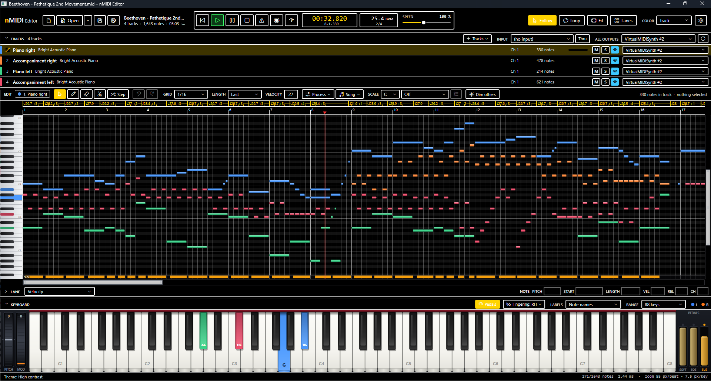
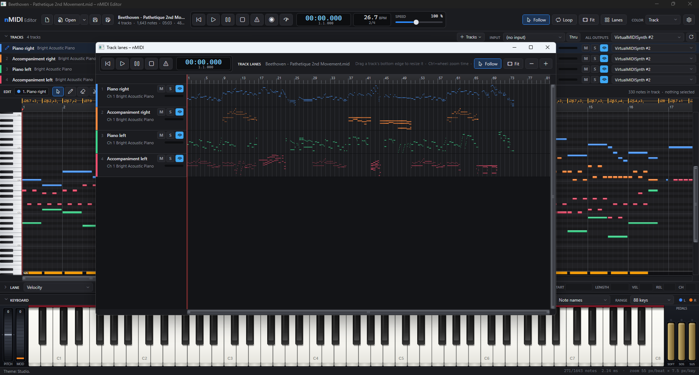

# nMIDI Editor

[](https://github.com/duskozi/nMidiEditor/actions/workflows/build.yml)

A MIDI editor and player for Windows with a piano roll, track lanes and an on-screen piano keyboard
that shows suggested hands and fingers. Open a `.mid` file (or start a new song) and edit it in the
piano roll: draw, select, move, copy, resize, split and delete notes, with snapping, undo and redo,
then save it back as a standard MIDI file. It grew out of nMIDI, a small MIDI player, and keeps
everything it does: the track lanes window, the keyboard with fingering, per-track mute, solo and
output port, speed, follow mode and panic.



### Themes

Four themes, switched from **Settings ▸ Theme**:

| Studio | Light classic |
| --- | --- |
|  |  |
| **Retro hardware** | **High contrast** |
|  |  |

The **Lanes** button opens every track in its own lane:



## Download

Get the latest `nMIDIEditor-<version>-win-x64.zip` from the
[Releases](https://github.com/duskozi/nMidiEditor/releases) page, unzip it anywhere and run
`nMIDIEditor.exe`. You need Windows 10 or 11 (64-bit) and the
[.NET 10 Desktop Runtime](https://dotnet.microsoft.com/download/dotnet/10.0).

## Editing

The track you edit is highlighted in the track list and named in the **EDIT** bar. Click a track
in the list to edit it, or click a note of another track in the piano roll. Notes of the other
tracks are dimmed (turn this off with **Dim others**).

**Several tracks at once:** Ctrl+click more tracks in the list to edit them together (for example the
right and left hand of a piano piece). They are drawn like the edited track and marked in the list, and
the EDIT bar shows "1. Piano RH + 1". Selecting, moving, copying, transposing, deleting, quantizing and
the other note commands work on notes of all of them, and every note stays in its own track. New notes,
pasted notes and the velocity and controller lanes use the first (active) track. Ctrl+click a track
again to stop editing it; a plain click goes back to one track.

### Tools

| Key | Tool | What it does |
| --- | --- | --- |
| 1 | Select | Click a note to select it, drag to move it (time and pitch), drag its left or right edge to resize. Drag on empty space for a selection box. Shift adds to the selection, Ctrl+click adds or removes a note, Ctrl+drag copies. Double-click empty space to add a note. Right-click for the edit menu. |
| 2 | Draw | Click to add a note, drag right to set its length. Existing notes can be moved and resized as with Select. Right-drag erases. |
| 3 | Erase | Click or drag over notes to delete them. |
| 4 | Split | Click a note to cut it in two at the nearest grid line. A selected note splits the whole selection. |

Hold **Alt** while dragging to place notes freely, without the grid.

**GRID** sets the snap (bar, 1/1 to 1/64, triplets, dotted, or off). **LENGTH** sets the length of
new notes ("Last" reuses the length you drew or resized last). **VELOCITY** sets the velocity of
new notes; clicking a note picks up its velocity.

Notes sound when you draw them, click them, or move them to another pitch. Clicking a key beside the
piano roll plays it and selects every note of that key in the edited track (Shift adds).

Edits are heard straight away, also while the song is playing.

### Shortcuts

| Key | Action |
| --- | --- |
| Ctrl+N / Ctrl+O | New song / open a file |
| Ctrl+S / Ctrl+Shift+S | Save / save as (format 1 or format 0) |
| Ctrl+Z / Ctrl+Y (or Ctrl+Shift+Z) | Undo / redo |
| Ctrl+A | Select all notes of the edited track |
| Ctrl+C / Ctrl+X / Ctrl+V | Copy / cut / paste at the playhead |
| Ctrl+D | Duplicate the selection right after itself |
| Ctrl+T | Add a track |
| Ctrl+E | Event list |
| Ctrl+, | Settings |
| Q | Quantize… |
| L | Loop on / off |
| R | Record |
| S | Step input on / off |
| C | Metronome on / off |
| Del or Backspace | Delete the selected notes (in step input, Backspace takes the last step back) |
| ↑ / ↓ | Transpose a semitone (Shift: an octave) |
| ← / → | Move the selection one grid step; with nothing selected, move the playhead |
| Ctrl+← / Ctrl+→ | Shorten / lengthen the selection by one grid step |
| 1 – 4 | Select, draw, erase, split tool |
| Esc | Cancel a drag, then clear the selection, then panic (all notes off) |
| Space | Play / pause |
| Home | Back to the start |
| F | Follow the playhead on / off |

### Saving

**Save** writes back to the file you opened, in the format it had (format 0 stays format 0).
**Save as** lets you choose format 1 (a conductor track plus one track per part) or format 0 (one
track). The file is written to a temporary file first and then moved into place, so a failed save
never leaves a broken file. Tempo and time signature changes, markers, lyrics, text, SysEx and other
meta events are kept. `.rmi` files are saved as a new `.mid` file. When you close the window or open
another file with unsaved changes, the editor asks whether to save them.

## Velocity and controller lanes

The lane under the piano roll (**Lane**, toggled with the button at its left) shows one kind of data of
the edited track: velocity, pitch bend, program change, channel pressure, any controller (CC 0–119),
or the song's tempo. Controllers the track already uses are marked ●.

- **Drag** to paint values. In the velocity lane, painting changes only the selected notes when there
  are any.
- **Shift-drag** draws a straight line (a ramp). In the velocity lane a right-drag does the same.
- **Right-drag** erases controller events.
- The value under the mouse shows in the lane header.

The **note fields** in the lane header (pitch, start, length, velocity, release velocity, channel) show
the selected note, or what the selected notes have in common. Type a value and press Enter. Pitch takes
names like `C4`, `F#3`, `Bb2` (middle C is C4) or a number; start takes `bar.beat.tick`; pitch, start,
length and velocity also take `+n` / `-n` to change every selected note by that much.

## Note processing

**Process ▾** (also in the right-click menu) works on the selected notes, or on the whole edited track
when nothing is selected. Each command is one undo step.

- **Quantize…** (Q): to the grid or any length, starts only, starts and ends, or ends only, with
  strength and swing.
- **Transpose…**: by semitones or octaves, optionally keeping notes in the chosen scale.
- **Length…**: set, scale, legato (each note up to the next), or remove overlaps.
- **Velocity…**: set, scale and add, or ramp from one value to another (crescendo / diminuendo).
- **Humanize…**: small random changes of timing, velocity and length.
- **Reverse**, **invert** (mirror pitches), **remove duplicate notes**.
- **Select notes…**: select the notes of a pitch range, velocity range, length range or channel.

**SCALE** picks a key and scale (major, minor, modes, pentatonic, blues and more). The piano roll
shades the notes outside the scale; with **Snap** on, drawn and moved notes stay in the scale.

## Song and tracks

- **Tracks ▾** (or right-click a track): track settings (name, channel, instrument, volume, pan),
  add, duplicate, delete and reorder tracks, merge tracks, split by channel, split by pitch (left and
  right hand), the event list, and export. Ctrl+T adds a track.
- **Song ▾**: insert or delete bars, cut / copy / paste / delete / clear the loop range across all
  tracks (with or without removing the time), insert silence, and tempo, time signature, key signature
  and marker changes at the playhead. **Go to marker** jumps to a marker.
- **The ruler** shows tempo, time signature, key and marker flags: click one to edit it, right-click
  for its menu. Drag in the upper band of the ruler to set the **loop range**; **L** turns looping on
  and off.
- **Tempo lane**: draw tempo changes like a controller.
- **Track lanes window**: drag in a lane to select a range of that track, drag the range to move it,
  and use Del, Ctrl+C / X / V / D on it.

## MIDI input: recording and step input

Choose your keyboard or controller in **INPUT** (above the track list). With **Thru** on, what you
play sounds on the edited track's port and channel.

**Recording** (the red button, or **R**): records notes, controllers, pitch bend and pressure into the
edited track. Press R, Space or Stop to end the take; the take is one undo step. Right-click the
record button to choose:

- **Overdub** (mix with what is there) or **Replace** (remove the notes of the recorded range),
- **Count in one bar** with the metronome,
- **Quantize the take** to the grid.

Recording also works while playing (punch in), and with the loop on (each pass adds to the take).

**Step input** (**Step**, or **S**): play a note or a chord on the MIDI input (or click the keyboard
below the roll). It goes in at the playhead with the **LENGTH** box's length, and the playhead moves
on. ← / → move the playhead (a rest), Backspace takes the last step back.

**Metronome** (the button next to record, or **C**): clicks on every beat while playing, on channel 10
of the edited track's port.

## Event list

**Ctrl+E** (or Tracks ▾ → Event list) lists every event of the edited track: notes, controllers,
programs, pitch bend, pressure and meta events. Another view shows the song's tempo, time signature,
key signature and marker events. Type in a cell and press Enter to change an event (position as
`bar.beat.tick` or a tick, channel, note or number, value, length). Del deletes the selected rows;
**Add ▾** adds a note, a controller or program change, or a song event at the playhead.

## Files

- **Recent files**: the button next to Open.
- **Export**: Tracks ▾ → export the edited track, or only its selected notes, as a MIDI file of its
  own (with the song's tempo map).
- **Autosave**: unsaved changes are saved every minute to `%AppData%\nMIDIEditor\autosave`. If the
  editor ends without closing normally, it offers to recover the work the next time it starts.
- Settings (recent files, MIDI input, recording options) are kept in `%AppData%\nMIDIEditor\settings.json`.

## Settings and themes

The gear button at the right of the top bar opens the settings menu: **Settings…** (Ctrl+,), the
**Theme** switch, and the settings folder.

- **Themes** (each one also colours the piano roll, ruler, lanes and title bar):
  - *Studio*, the default: dark, crisp bordered buttons and combo boxes, blue-lit toggles, Inter and
    JetBrains Mono when they are installed.
  - *Light classic*: light grey panels, raised gradient buttons, white fields and a light piano roll.
  - *Retro hardware*: charcoal and brushed metal, an amber LCD, square bevelled buttons and orange accents.
  - *High contrast*: black, white text, yellow selection and hover, thick borders.

  The theme changes at once and is remembered.
- **Settings…**: default MIDI output (optionally applied to every track of the open song), default
  MIDI input and Thru, recording mode, count-in and quantize, autosave interval (0 turns it off),
  reopening the last file at start-up, the tempo of new songs, piano keyboard visibility, height,
  labels and range, lane visibility and height, and the editor defaults (grid, note length, velocity,
  dimming other tracks, follow, note colour), and fingering (scale runs, fast repeats, where the hands
  come from, fingers on notes, saving fingering in the MIDI file).

When the window is narrow, the top bar and the edit toolbar make room step by step: buttons show only
their icons (the tooltips still explain them), labels and the speed slider shrink, and below about
1,100 pixels the view options move to a second row. The time and tempo displays have a fixed width, so
the bar no longer shifts while playing.

The layout (keyboard and lane height, which panels are open, toolbar choices) is also remembered when
you close the editor.

## Fingering

Every keyboard track gets a hand and a finger for each note, from the nPianoFingering engine. The
fingering is worked out in the background, and after an edit only the notes around it are fingered
again (one edit in a part of 3,500 notes takes about 15 ms).

- **Fingers on notes**: a small badge on each note, blue for the left hand and orange for the right,
  for the edited track or for all fingered tracks (Fingering ▸ Fingers on notes, or Settings). The
  keyboard shows them while playing.
- **What is fingered** (Tracks ▾ ▸ Fingering, the **Fingering** button above the keyboard, or right-click a
  track): *Auto* fingers keyboard instruments only (pianos, harpsichord, clavinet, celesta, organs, and
  tracks named like piano parts); *Both hands*, *Left hand*, *Right hand* or *Off* set it for the track.
- **Pairs**: a piano written on two tracks is fingered as one part, so an edit in one track refingers
  both. Pairs are found automatically (a LH and a RH track by name, or the only two neighbouring piano
  tracks, the lower one as the left hand), or chosen with *Paired with*.
- **Hands** come from the tracks when the file has them, or always from the tracks, or always from the
  algorithm (Fingering ▸ Hands).
- **Correcting a finger**: select notes and press **Shift+1** to **Shift+5** (or use Fingering ▸ Set
  finger). The finger is kept from then on and the notes around it are fingered to fit; a yellow ring
  marks it. **Shift+0** removes the correction. Corrections move with their notes and are undoable.
- **Saved in the MIDI file**: fingering modes, pairs and corrections are written as text events
  ("nMIDI:fingering …", "nMIDI:finger 60 R3"), so they come back when the file is opened. Settings ▸
  Fingering ▸ *Save in MIDI file* turns this off.
- **Fingering report** (Ctrl+Shift+F, or Fingering ▸ Fingering report…), for each fingered part:
  - *Hands agree with the file*: the algorithm's own split, with the file's hands ignored, against the
    LH/RH tracks.
  - *Fingers match*: the shown fingers against fingers written in the file (text or lyric events "1"–"5",
    or "L3", "R2"), or against a PIG fingering file (*Compare with PIG file…*).
  - *Hand and finger both right*, *Agrees with your corrections* (what the engine chose before you
    corrected it), *Stability* (the fingering shown while editing against a fresh full run) and the share
    of notes fingered from scale charts.
  - A list of bars with their differences (double-click to go there), **Show differences** to outline
    them in red in the piano roll, and **Previous** / **Next** to step through them.

## Mixer

The **Mixer** button opens a mixer with one channel strip per track and a master strip:

- **R** makes the track the edited (and recorded) track; clicking the coloured name does the same.
- **M** and **S** mute and solo, the same as in the track list (right-click: only this track).
- **Pan** and four effect knobs: **Reverb** (CC 91), **Chorus** (CC 93), **Delay** (CC 94, GS and XG synths)
  and **Bright** (filter cutoff, CC 74).
- A **volume fader** (CC 7) with a dB scale and an activity meter.
- **↺** gives a strip back to the song; the master strip has **Reset all**, **Clear M / S**, a master mute and a
  master fader that scales every track's volume.

Each control shows the song's value at the playhead and moves with it while the song plays. Once you move a
control, the mixer's value replaces the song's events for that controller until you reset the strip. Mixer
settings are not saved in the MIDI file. The mixer's panels, labels, displays and meters follow the app theme; the
knobs, faders and buttons keep a dark hardware look in every theme.

**Pause main view** in the Lanes window stops drawing the main window's piano roll, playhead and keyboard while
you work in the Lanes window, to save CPU. The main window catches up as soon as you click it.

## Player features (from nMIDI)

- **Track lanes window** (the **Lanes** button): every track in its own lane, with resizable lanes
  and a zoomable time line. It follows your edits.
- **Piano roll** with one colour per track, zoom and scroll, bar, beat and grid lines, and a ruler you
  can click to move the playhead.
- **Piano keyboard** under the roll with the track colour on pressed keys, and either the finger
  number (L/R hand) or the note name.
- **Pitch bend and modulation wheels** at the left of the keyboard show the edited track's pitch bend and
  modulation (CC 1) at the playhead, moving while it plays, or what comes in from the MIDI input. Drag a
  wheel to send it to the edited track's port; the pitch wheel springs back when released, and a
  double-click resets a wheel.
- **Pedals** at the right of the keyboard (soft, sostenuto, sustain, as on a grand) go down and light up
  while the song presses them at the playhead, or while you press a pedal on the MIDI input. Hold the
  mouse on a pedal to send it. Switch them on or off with **Pedals** in the keyboard bar (or in Settings).
- **Pedal strip** along the bottom of the piano roll: sustain (CC 64), sostenuto (CC 66) and soft (CC 67)
  of the edited tracks, as bars while the pedal is down (half-pedalling shows as a lower bar). If the
  edited tracks have no pedal data, the pedals of the visible tracks are shown. Edit the values in the
  lane by choosing **Sustain pedal** (or 66 / 67). Turn the strip off in Settings, Editor, Pedals.
- **Ruler**: tempo, time signature, key and marker flags. Flags that would overlap are merged into one
  label ("♩85.7 +12"; the tooltip lists them), and dense tempo changes also show as a tempo line.
- **Per-track control**: mute, solo, show or hide notes, and a MIDI output port for each track.
  Right-click M, S or the eye button to make that track the only one.
- **Speed** from 25 % to 200 %, **follow mode**, and **panic**.
- Opens `.mid`, `.midi`, `.kar` and `.rmi`, from the Open button, by drag and drop, or from the
  command line: `nMIDIEditor.exe song.mid`.

## Requirements

- Windows 10 or 11, 64-bit
- [.NET 10 Desktop Runtime](https://dotnet.microsoft.com/download/dotnet/10.0)
- A MIDI output. Windows comes with the *Microsoft GS Wavetable Synth*, which is picked by default.

## Building

You need the .NET 10 SDK (or Visual Studio 2026 with the .NET desktop workload).

```
git clone https://github.com/duskozi/nMidiEditor.git
cd nMIDIEditor
dotnet build nMIDIEditor.sln -c Release
```

The program ends up in `bin/Release/net10.0-windows/nMIDIEditor.exe`. Open `nMIDIEditor.sln` in
Visual Studio or Rider to work on it.

The song model (loading, editing, undo, saving, fingering, pedals) has tests that run on any OS,
so they also run on Linux or macOS where the WPF app itself can't be built without
`-p:EnableWindowsTargeting=true`:

```
dotnet test tests/nMIDIEditor.Tests.csproj
```

A release build for distribution:

```
dotnet publish nMIDIEditor.csproj -c Release -r win-x64 --self-contained false -o publish
```

Publishing a release on GitHub (for example with the tag `v2.4.1`) makes the GitHub Actions workflow build, test and attach the zip to it.

### Microsoft Store package

`nMIDIEditor.Store.sln` adds `Package/nMIDIEditor.Package.wapproj`, which packages the editor as MSIX for the
Microsoft Store. It needs Visual Studio on Windows with the **MSIX Packaging Tools** component of the .NET desktop
workload, so it is not part of `nMIDIEditor.sln` or the CI build.

1. Open `nMIDIEditor.Store.sln` and set `nMIDIEditor.Package` as the startup project (F5 installs and runs the
   package locally).
2. Right-click it, then **Publish > Associate App with the Store**, and pick the name reserved in Partner Center.
   This fills in the package identity in `Package.appxmanifest`.
3. **Publish > Create App Packages > Microsoft Store**, x64, Release. Upload the `.msixupload` file in Partner Center.

The package holds a self-contained build (`Properties/PublishProfiles/win-x64.pubxml`), so Store users don't need
.NET installed. The Store signs the package. Raise the version in `Package.appxmanifest` together with
`nMIDIEditor.csproj`; the Store wants the last number to be 0.

## Project layout

| Folder | What is in it |
| --- | --- |
| `Model/` | The editable song, note edits and processing, song and track operations, undo history |
| `PianoRoll/` | Note skins, grid, key strip, ruler, the mouse editor (`RollEditor.cs`) and the controller lane |
| `Lanes/` | The track lanes window: shared time axis, lanes and ruler |
| `Playback/` | The player thread, the MIDI output ports and the MIDI input |
| `Piano/` | The on-screen piano keyboard, the pitch and modulation wheels and the pedals |
| `Theory/` | Note names, and the bridge to the fingering engine |
| `Themes/` | The four themes and the theme switch |
| `Assets/` | App and window icons |
| `Controls/` | nMIDI.Controls, the knobs, faders, meters and buttons of the mixer (its own project) |
| `Package/` | The Microsoft Store (MSIX) package: manifest and tile images |
| `tests/` | Tests for the song model |
| `lib/NinePatchWpf/` | Prebuilt NinePatchWpf, which draws the piano roll |
| `lib/nPianoFingering/` | Prebuilt nPianoFingering engine (hand separation and fingering) |

The main window is split by subject: `MainWindow.xaml.cs` (player), `MainWindow.Editing.cs` (tools,
commands, shortcuts, saving), `MainWindow.Lanes.cs` (controller lane, note fields), `MainWindow.Process.cs`
(note processing), `MainWindow.Song.cs` (loop, ruler, tracks, song commands) and `MainWindow.Record.cs`
(MIDI input, recording, step input, metronome, recent files, autosave, export) and `MainWindow.Settings.cs`
(settings menu and window, theme switch, remembered layout), `MainWindow.Fingering.cs` (fingering modes,
pairs, corrections, fingers on notes), `MainWindow.Wheels.cs` and `MainWindow.Pedals.cs` (wheels and pedals),
`MainWindow.Mixer.cs` (mixer link, pausing the note view) and `MainWindow.Layout.cs` (top bar and toolbar at
narrow widths). `MixerWindow.xaml` is the mixer, built from the `nMIDI.Controls` library.
`EventListWindow.cs`, `FingeringReportWindow.cs` and `FormDialog.cs` are built in code. `Model/Fingering.cs`
fingers the song in the background, and `Model/FingeringReport.cs` computes the report.

## Libraries

- [DryWetMidi](https://github.com/melanchall/drywetmidi) by Maxim Dobroselsky (MIT) reads and writes
  the files and talks to the MIDI ports.
- NinePatchWpf, a nine-patch rendering and zoom-viewer library by the same author as nMIDI,
  included as prebuilt DLLs in `lib/NinePatchWpf`.
- nPianoFingering (by the same author) finds the hand and finger of every note shown on the
  keyboard: a beam search splits each track between the hands (a track named LH / RH, "left",
  "right" … stays in one hand), and a Viterbi-style search with standard scale charts fingers each
  hand. It is included as a prebuilt DLL (version 1.1) in `lib/nPianoFingering`; the editor uses its
  incremental `FingeringSession`, so only the notes around an edit are fingered again.

## Changes

See [CHANGELOG.md](CHANGELOG.md).

## License

GNU General Public License v3.0, see [LICENSE](LICENSE).
